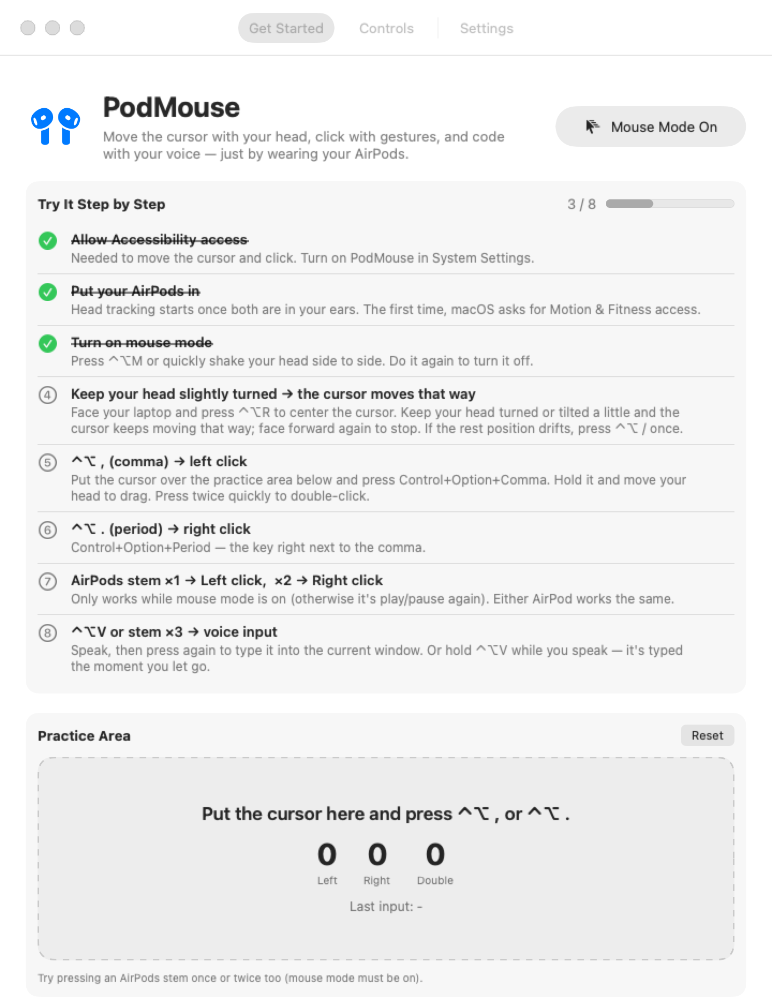
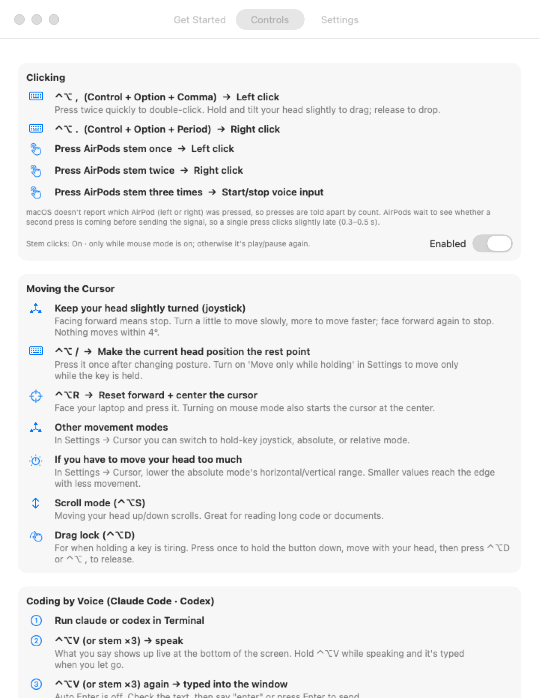
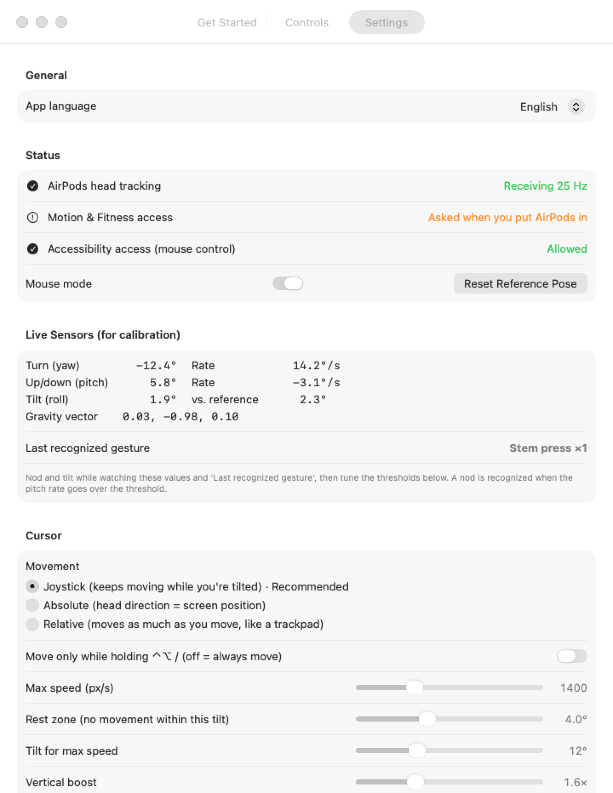

# PodMouse — AirPods Mouse

[한국어](README.md) | **English**

A macOS menu bar app that turns your AirPods into a mouse. The motion sensors in head-tracking AirPods
(AirPods 3rd gen and later · AirPods Pro · AirPods Max) move the cursor. You click with head gestures, stem presses, or shortcuts, and you can
code by voice in Claude Code or Codex.

<p align="center">
  
</p>

## Features

- 🎧 **Your AirPods become a mouse.** No extra hardware: tilt your head slightly and the head-tracking sensors in your AirPods move the cursor.
- 🖱️ **Click almost hands-free.** Press an AirPods stem once or twice to left- or right-click, or use ⌃⌥ shortcuts to click, drag and scroll.
- 🗣️ **Code by voice.** Press the stem three times (or ⌃⌥V) to dictate. The text goes straight into the terminal running Claude Code or Codex.
- 🧭 **Easy to learn.** A step-by-step checklist ticks itself off as you try each step, and a practice area lets you test clicks.
- ⚙️ **Fine-grained calibration.** Tune sensitivity, dead zone and gesture thresholds while watching live sensor values.
- 🌐 **English / 한국어.** Follows your system language. Change it in Settings → App language or menu bar → Language.

## Screenshots

| Get Started | Controls | Settings |
|---|---|---|
|  |  |  |
| Step-by-step checklist + click practice area | Every action and shortcut explained | Status, live sensors, cursor tuning |

## Requirements

- macOS 14 (Sonoma) or later
- AirPods with head tracking (see [Supported devices](#supported-devices))
- A Mac with Apple silicon is recommended (Intel Macs haven't been tested)
- Xcode or the Command Line Tools (`swiftc`). There's no Xcode project; `build.sh` builds everything.

## Supported devices

PodMouse reads sensor data through Apple's headphone motion API (`CMHeadphoneMotionManager`, macOS 14 and later).
This API only provides data for **devices that support Spatial Audio with head tracking**.

| Device | Cursor movement | Click button | Verified |
|---|---|---|---|
| AirPods 4 (standard / ANC) | ✅ | Stem press | Tested during development |
| AirPods (3rd generation) | ✅ | Stem press | Per Apple's head-tracking list (not tested) |
| AirPods Pro (all generations) | ✅ | Stem press | 〃 |
| AirPods Max | ✅ | Digital Crown press | 〃 |
| Beats Fit Pro | ✅ | Button press | Per Apple's Spatial Audio docs (not tested) |
| AirPods (1st / 2nd generation) | ❌ | — | No head-tracking sensors |

- AirPods 1st/2nd gen do have accelerometers, but only for ear detection and taps. They have no gyroscope to track head direction and tilt.
- Clicks come from the play/next/previous signals sent by 1/2/3 presses of the stem or crown, so button presses on the devices above should work the same way.
- Head gestures such as nod and shake are detected by PodMouse itself from the sensor data. They work on any head-tracking model, even ones without Apple's own head gestures (answering/declining calls).
- To check your AirPods: put them in and see whether the values move under **Settings tab → Live Sensors**. If they're not supported, the menu bar shows "Head tracking unavailable".
- Apple supports Spatial Audio head tracking on Macs with Apple silicon. Intel Macs haven't been tested.

## Install (Terminal)

Paste this into Terminal. It downloads, builds and installs PodMouse to `/Applications`, then launches it.

```bash
git clone https://github.com/tony1010-dev/PodMouse.git ~/PodMouse
cd ~/PodMouse
./install.sh
```

What `install.sh` does:
- Checks your macOS version and that a Swift compiler (Command Line Tools) is installed
- Builds the app, installs `/Applications/PodMouse.app` and launches it
- If the default SDK doesn't match your compiler (`this SDK is not supported by the compiler`), retries with your other installed SDKs

> If it says the Command Line Tools are missing, run `xcode-select --install` first.

### Update

```bash
cd ~/PodMouse && git pull && ./install.sh
```

### Uninstall

```bash
~/PodMouse/install.sh uninstall
rm -rf ~/PodMouse
```

Also remove PodMouse from System Settings → Privacy & Security → Accessibility.

### Build manually

```bash
./build.sh            # creates build/PodMouse.app
./build.sh install    # installs to /Applications and launches
SDKROOT=/Library/Developer/CommandLineTools/SDKs/MacOSX26.sdk ./build.sh   # pick an SDK
```

If you have a developer certificate (Apple Development / Developer ID), it's used to sign the app automatically.
Otherwise the app is signed ad hoc, and you may need to re-enable Accessibility access after every rebuild.
Set `PODMOUSE_SIGN_IDENTITY` to choose a specific certificate.

## First launch

The **PodMouse window** opens on launch:
- **Get Started**: a step-by-step checklist (ticks itself off as you try it) and a click practice area
- **Controls**: every action and shortcut explained
- **Settings**: sensitivity, gesture thresholds, action assignments and live sensor values

Closing the window keeps the app running in the menu bar. Reopen it from the menu bar icon → "Open Guide…",
or launch PodMouse again from Finder or Spotlight.

Permissions to allow:
1. **Accessibility**: moving the cursor, clicking and typing (System Settings → Privacy & Security → Accessibility)
2. **Motion & Fitness**: asked when you put your AirPods in
3. **Microphone / Speech Recognition**: asked the first time you use voice input

The app language follows your system language (Korean if your system is Korean, otherwise English). Change it in
Settings tab → General → **App language**, or menu bar → **언어 / Language**. Changing it also switches the speech
recognition language.

## Controls

| Input | Action |
|---|---|
| Turn head left/right, up/down | Move the cursor |
| ⌃⌥ , (Control+Option+Comma) | Left click · twice = double-click · hold and move your head = drag |
| ⌃⌥ . (Control+Option+Period) | Right click |
| Press AirPods stem once | Left click |
| Press AirPods stem twice | Right click |
| Press AirPods stem three times | Start/stop voice input |

- Stem presses only become clicks **while mouse mode is on**. When it's off, they go back to play/pause.
- macOS doesn't report which AirPod (left or right) was pressed, so presses are told apart by count.
  AirPods wait to see whether a second press is coming before sending the signal, so a single press clicks about 0.3–0.5 s late.
- Head gestures are off by default. Turn them on with ⌃⌥G (or Settings → Head Gestures) to get tilt left = voice input
  and head shake = toggle mouse mode. You can assign clicks to head gestures in Settings.

## Cursor modes

- **Joystick (default)**: keep your head slightly turned away from forward (set with ⌃⌥R) and the cursor keeps moving
  that way; face forward again to stop. The more you turn, the faster it goes. If the rest point drifts, press ⌃⌥ / once
  in a comfortable pose. Turn on "Move only while holding ⌃⌥ /" in Settings to move only while the key is held. The cursor
  then locks when you let go, so it doesn't wobble while you click.
- **Absolute**: forward = screen center, head direction = cursor position.
- **Relative**: the cursor moves as much as you move, like a trackpad.

To start, face your laptop and press ⌃⌥R. The cursor jumps to the center and that direction becomes "forward".

## Shortcuts (⌃ Control + ⌥ Option)

| Key | Function |
|---|---|
| ⌃⌥M | Toggle mouse mode |
| ⌃⌥ / | Make the current head position the rest point (key mode: move while held) |
| ⌃⌥ , / ⌃⌥ . | Left / right click |
| ⌃⌥V | Voice input (tap = on/off, hold = record while held) |
| ⌃⌥R | Reset reference pose + center the cursor |
| ⌃⌥D | Start/end drag lock |
| ⌃⌥S | Scroll mode (scroll with your head) |
| ⌃⌥G | Toggle head gestures |
| ⌃⌥= / ⌃⌥- | Increase / decrease sensitivity |

## Coding by voice (Claude Code / Codex)

1. Run `claude` or `codex` in Terminal
2. ⌃⌥V (or stem ×3) → speak → ⌃⌥V again
3. The recognized text is pasted into the focused window
   - Pick your terminal app in the menu bar → **Voice Input Target** to send text there even while another window is in front
   - Turn on **Auto Enter After Voice Input** to send right away
   - Say just "enter" / "send" to press Enter, or "cancel" for Esc

PodMouse uses the macOS default input device. To use the AirPods mic, select your AirPods under Control Center → Sound → Input.

## Calibration tips

- First check that the values move under **Live Sensors** in Settings. If they don't, reseat your AirPods or reconnect Bluetooth.
- If the cursor moves the wrong way, use **Invert horizontal/vertical**. If tilt is detected backwards, use **Invert tilt**.
- If the cursor slowly drifts, raise the **dead zone** and press ⌃⌥R to reset the reference.

## Limitations

- Head-tracking data only comes **while the AirPods are in your ears**. AirPods in the charging case don't send sensor
  data, and the public APIs can't detect the case lid opening or closing, so using the case as a mouse isn't supported.
- With automatic ear detection turned off, holding the AirPods in your hand sometimes produces data. Check it on the Live Sensors screen.
- The sensors update at about 25 Hz, so movement is interpolated to 120 Hz to keep it smooth.

## License

[MIT](LICENSE)
